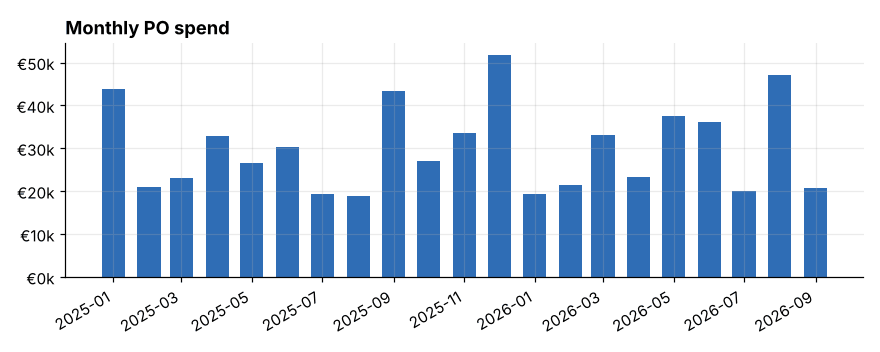
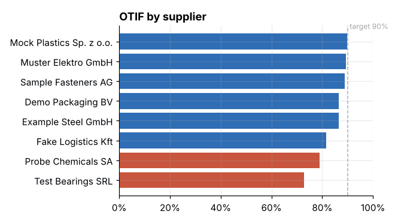
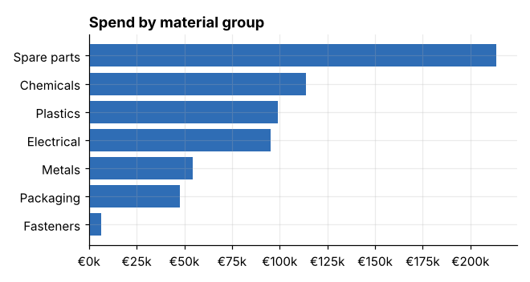

# sap-p2p-analytics

Small Python project to analyse procure-to-pay data the way I'd want to see it as an MM consultant: spend, delivery performance, invoice price variances and a simple supplier scorecard.

The data is generated (no client data), but the tables and field names follow SAP - EKKO, EKPO, EBAN, MSEG, RSEG, LFA1 - so the same code can run on a real SE16N / CDS extract with very few changes.



## What it shows

**Spend**
- total spend, number of POs, average PO value
- monthly trend, spend by material group
- supplier ABC (A = top 80% of spend)
- PO lines created without a purchase requisition

**Delivery**
- OTIF per supplier (on time = first GR within delivery date + tolerance, in full = GR qty >= PO qty)
- list of late lines with days late
- PR to PO lead time

**Invoices**
- invoice unit price vs PO price per line, lines over tolerance
- amount paid above PO price
- lines with payment block R
- rough GR/IR difference per PO line

**Supplier scorecard**
- combined score from OTIF and price compliance, weights adjustable

<p>


</p>

## Run it

```bash
pip install -r requirements.txt

python generate_data.py      # creates the sample CSVs in ./data
python report.py             # prints KPIs, saves charts to ./images
streamlit run app.py         # interactive dashboard
```

If `data/` is empty, `report.py` and `app.py` generate the sample data themselves on the first run. Use `--seed` for a different dataset.

The dashboard has filters for date, supplier and material group, and sliders for the on-time and price tolerances so you can see how much the numbers move.

## Files

| file | what |
|---|---|
| `generate_data.py` | creates the sample dataset (seeded, so it's reproducible) |
| `kpis.py` | all the calculations - plain pandas, no Streamlit in here |
| `report.py` | console summary + PNG charts |
| `app.py` | Streamlit dashboard |
| `data/` | sample CSVs (generated, not committed) |

## Using real SAP data

Download these with SE16N (or better, from CDS views / a BW extract) and save them as CSV with the same names as in `data/`:

| file | table | fields used |
|---|---|---|
| ekko_po_header | EKKO | EBELN, BSART, LIFNR, EKORG, EKGRP, BEDAT, WAERS |
| ekpo_po_items | EKPO + EKET | EBELN, EBELP, MATNR, MATKL, WERKS, MENGE, NETPR, PEINH, NETWR, BANFN, BNFPO, EINDT (from EKET) |
| eban_requisitions | EBAN | BANFN, BNFPO, MATNR, MENGE, WERKS, BADAT |
| mseg_goods_receipts | MSEG / MATDOC | MBLNR, MJAHR, BWART, EBELN, EBELP, MATNR, MENGE, BUDAT, DMBTR |
| rseg_invoices | RSEG + RBKP | BELNR, GJAHR, EBELN, EBELP, LIFNR, BUDAT (from RBKP), MENGE, WRBTR, ZLSPR |
| lfa1_suppliers | LFA1 | LIFNR, NAME1, LAND1 |
| t023_material_groups | T023T | MATKL, WGBEZ |

Things to watch with real data:
- EKET can have several schedule lines per item - I take the first delivery date here, adjust if you need it per schedule line
- filter MSEG on movement type 101 and subtract 102/122 if you want net receipts
- deleted PO items (EKPO-LOEKZ) should be excluded
- currencies - the sample is all EUR, real data needs conversion to company code currency
- in S/4 read from MATDOC or the I_MaterialDocumentItem view instead of MSEG

## Ideas for later

- add QM rejection rate to the scorecard
- price trend per material vs info record price
- maverick buying by purchasing group over time
- Power BI version of the same model

Feedback welcome - open an issue.
